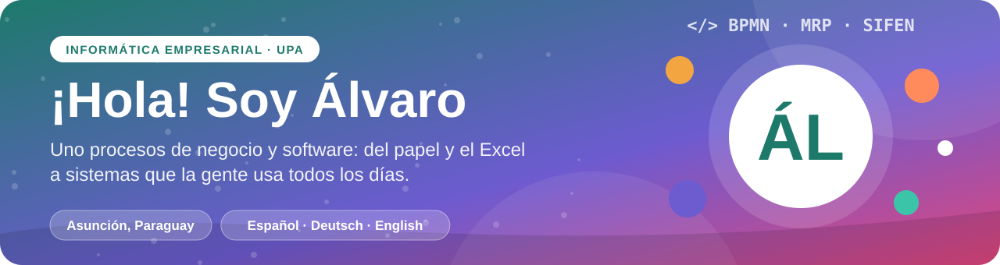
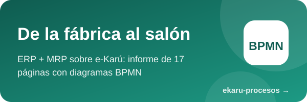
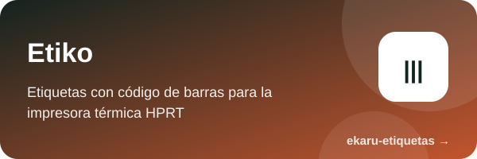
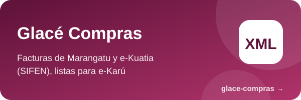
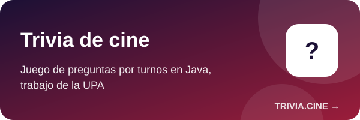
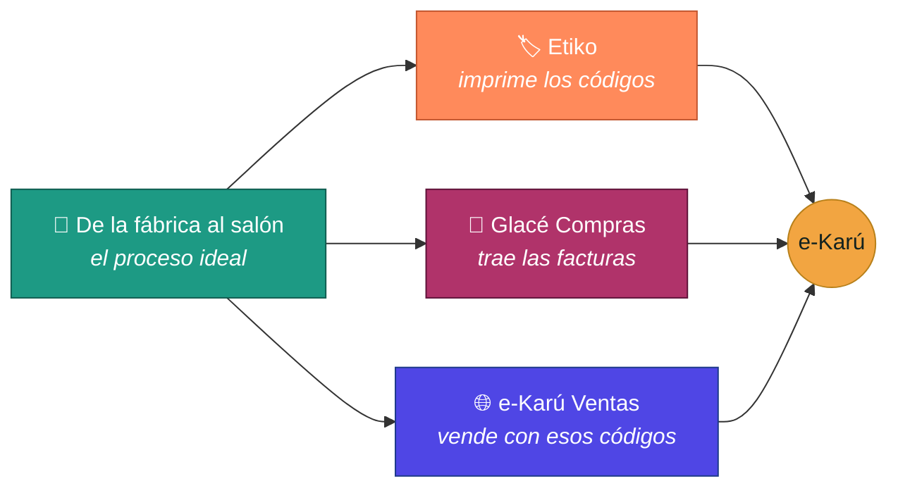

## 🛠️ En qué trabajo

<table>
<tr>
<td width="50%"></td>
<td width="50%"></td>
</tr>
<tr>
<td width="50%"></td>
<td width="50%"></td>
</tr>
<tr>
<td width="50%"></td>
<td width="50%" valign="middle">

| | Proyecto | En una línea |
|:-:|---|---|
| 🍦 | **De la fábrica al salón** | ERP con MRP sobre e-Karú, todo con códigos de barra |
| 🏷️ | **Etiko** | Diseña e imprime etiquetas en una impresora térmica |
| 🧾 | **Glacé Compras** | De Marangatu y e-Kuatia (SIFEN) al sistema de ventas |
| 🌐 | **Páginas web** | Prototipos de venta y un sitio de pedidos en línea |
| 🎬 | **TRIVIA.CINE** | Juego de preguntas por turnos en Java |

</td>
</tr>
</table>

> [!NOTE]
> Los repositorios de proyectos para clientes son privados.

### 🔗 Cómo se conectan

## 🧰 Herramientas

## 📚 Lo que estoy aprendiendo

| 🔄 Procesos | 🗄️ Datos | 🌐 Web |
|---|---|---|
| Modelado BPMN, planificación MRP y facturación electrónica en Paraguay (SIFEN) | Bases de datos y normalización | Desarrollo web |

Otra cuenta: <a href="https://github.com/liuzzialvaro432-dotcom">@liuzzialvaro432-dotcom</a>

